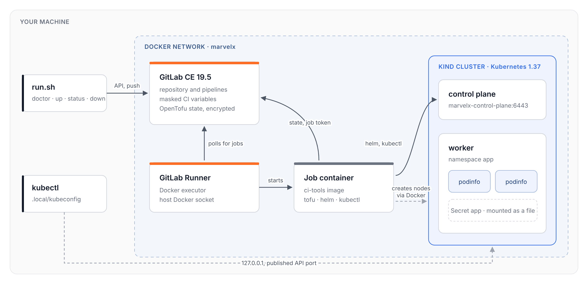
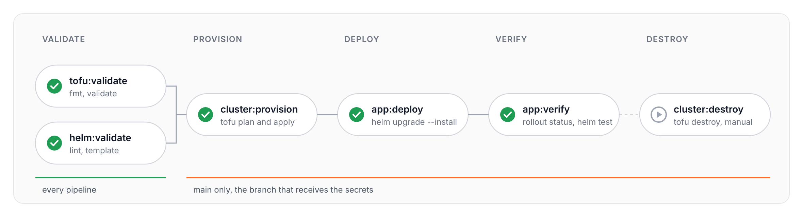

<h1 align="center">MarvelX DevOps take-home</h1>

<p align="center">
  A self-hosted GitLab, a kind cluster provisioned with OpenTofu,<br>
  and a pipeline that deploys a Helm chart and verifies it, all on one machine.
</p>

<p align="center">
  
  
  
  
</p>

<p align="center">
  <a href="#quick-start">Quick start</a> ·
  <a href="#how-it-works">How it works</a> ·
  <a href="#design">Design</a> ·
  <a href="#secrets">Secrets</a> ·
  <a href="#trade-offs">Trade-offs</a>
</p>

<br>




## Quick start

### 1. Install the requirements

You need Docker with at least 8 GB of memory, plus `git`, `curl`, `jq`, `openssl` and `kubectl`. OpenTofu, Helm and kind run inside the CI image, so you don’t need to install them.

```bash
brew install --cask orbstack    # or Docker Desktop
brew install jq kubectl         # git, curl and openssl ship with macOS
```

<details>
<summary>On Debian or Ubuntu</summary>

<br>

```bash
sudo apt-get install -y git curl jq openssl
```

Then install [Docker Engine](https://docs.docker.com/engine/install/), add your user to the `docker` group, and install [kubectl](https://kubernetes.io/docs/tasks/tools/).

</details>

### 2. Check your machine

```bash
./run.sh doctor
```

This lists each tool and its version, and warns if Docker has less than 6 GB of memory.

### 3. Run it

```bash
./run.sh up
```

> [!NOTE]
> The first run takes about ten minutes, mostly waiting for GitLab to boot. Later runs take two or three.

When the pipeline finishes, the script prints the result and the running pods.

### 4. Look around

GitLab is at [http://localhost:8080](http://localhost:8080). Log in as `root` with the password in `.local/root-password`, and open **marvelx → Build → Pipelines**.

```bash
export KUBECONFIG=$PWD/.local/kubeconfig
kubectl -n app get pods
kubectl -n app port-forward svc/app 9898:9898    # then open http://localhost:9898
```

`./run.sh status` shows the containers, the latest pipeline and the pods at any time.

### 5. Clean up

```bash
./run.sh down            # removes the containers and the cluster, keeps GitLab's data
./run.sh down --purge    # removes everything, including the local credentials
```


## How it works

`run.sh` follows GitHub’s [Scripts to Rule Them All](https://github.com/github/scripts-to-rule-them-all) pattern: one script with a few subcommands, so getting from a fresh clone to a running setup doesn’t require reading the code first. `doctor` only checks and never installs anything, so it won’t change your machine.

`./run.sh up` goes through these steps and skips any that are already done:

1. Starts GitLab CE 19.5.3 on a Docker network called `marvelx`, listening only on `127.0.0.1:8080`.
2. Sets a random root password and creates an API token that expires in seven days.
3. Creates the project and two secret CI variables.
4. Builds the CI image and registers a runner that uses the Docker executor.
5. Pushes the current commit and follows the pipeline until it finishes.
6. Writes a kubeconfig for the cluster to `.local/`.

The pushed commit starts this pipeline:



Validation runs on every pipeline. The other jobs run only on `main`, because that’s the only branch that gets the secrets. To deploy a different image tag or replica count without a commit, set the CI variables `APP_IMAGE_TAG` or `APP_REPLICAS` and run the pipeline again.


## Design

### One network for everything

GitLab, the job containers and the kind nodes all join the `marvelx` network. Jobs reach GitLab as `gitlab` and the Kubernetes API as `marvelx-control-plane:6443`, without going through the host.

### Secrets never appear in the repo, a log or a command

`run.sh` generates them and stores them in GitLab as masked, hidden and protected variables. The deploy job passes the app secret to Helm through a temporary file.

### Encrypted state in GitLab

GitLab stores the OpenTofu state and handles locking. The state contains the cluster’s admin key, so OpenTofu encrypts it before uploading it.

### Running it twice changes nothing

On a second pipeline, OpenTofu reports no changes and Helm creates a new revision without restarting any pods.

### Failures stop early

The chart won’t render without a secret, Helm rolls back if the pods don’t become ready, and `helm test` checks that the Service returns the version that was deployed.


## Secrets

| Secret | Stored in | Used for |
|---|---|---|
| `APP_SECRET` | GitLab CI variable | The Kubernetes Secret `app`, mounted into the pods as a file |
| `TOFU_STATE_PASSPHRASE` | GitLab CI variable | Encrypting the OpenTofu state |
| API token, root password, kubeconfig | `.local/`, readable only by you | `run.sh` and `kubectl` on your machine |

There’s no manual secret setup, because `run.sh` creates both CI variables. The secret is mounted as a file rather than an environment variable, because podinfo’s `/env` endpoint prints environment variables.

Kubernetes Secrets are only base64-encoded, and Helm stores a copy of the values in its release record. Anyone who can read Secrets in the `app` namespace can read the value.


## Trade-offs

> [!IMPORTANT]
> CI jobs can control Docker on the host. Run this on a machine you trust, not on shared infrastructure.

- The runner uses the host’s Docker socket, because the provisioning job needs Docker to create the kind nodes. This gives jobs root-level access to the host. Docker-in-Docker needs privileged containers, so it isn’t safer. On shared infrastructure, I’d run CI on isolated hosts or use the Kubernetes executor.
- kind joins the `marvelx` network through `KIND_EXPERIMENTAL_DOCKER_NETWORK`. The setting has worked reliably for years, but kind still calls it experimental.
- GitLab’s built-in state backend needs no extra service and includes locking, but the state only exists in this GitLab instance.
- The CI image is built locally, because a registry would need TLS. Downloads are checked against their published checksums. That catches a corrupted download, but not a compromised source.
- The app is podinfo rather than an image built by the pipeline, which would also need a registry. podinfo has the health, readiness and version endpoints the checks need.
- The kind provider isn’t signed in the OpenTofu registry. The lock file pins its checksums for macOS and Linux.
- The kind provider also doesn’t mark the cluster’s keys as sensitive, so a plan that replaces or destroys the cluster would print the admin key in the job log. The pipeline saves plans without printing them and shows a summary of actions and resource names instead.
- There’s no ingress. `kubectl port-forward` is enough to reach the app, and it keeps the published ports to two.


## With more time

- Build, sign and push the CI image from its own pipeline, and pin jobs to its digest.
- Post the OpenTofu plan and the rendered chart diff on each merge request.
- Encrypt Secrets at rest, or use the External Secrets Operator with a real secret store.
- Add NetworkPolicies so only the Service reaches the pods.
- Validate rendered manifests with kubeconform.
- Move to the Kubernetes executor, so jobs don’t need the Docker socket.
